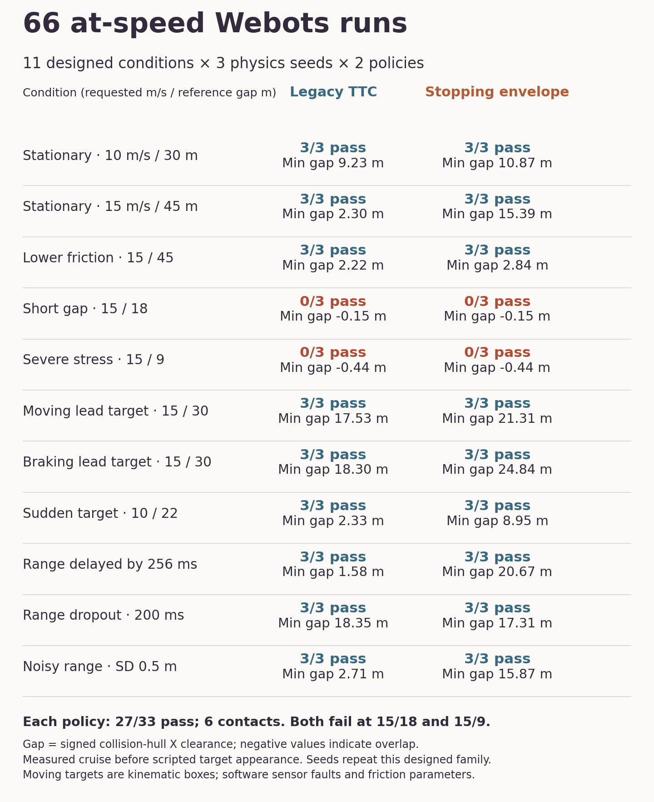
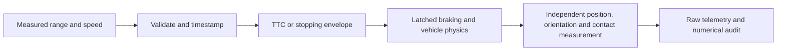

# Autonomous Braking Simulation

Connect range sensing, risk decisions and vehicle control to independently measured stopping behavior in Webots.

## At-speed validation

**66 fresh Webots executions:** 11 designed conditions × three physics seeds × two controllers. The vehicle reaches verified cruise at 10 or 15 m/s before each scripted hazard appears. Conditions include moving and decelerating targets, lower contact friction, delayed range, dropouts, noise and short gaps.

**Both controllers pass 27/33 executions and record six contacts.** A conservative stopping-envelope controller increases clearance in several conditions, including the delayed-range case, but does not improve the pass count or remove short-gap collisions. All outcomes remain visible.



[Every result, protocol and limits](results/at-speed-v2/RESULTS.md) · [Recorded numerical values](results/at-speed-v2/summary.json) · [Numerical audit](results/at-speed-v2/audit.json).

## Implementation

A common frontend validates range and speed, recognizes no-hit range and holds full brake during bounded initialization. The comparison uses the adapted legacy TTC controller and a conservative stopping-envelope policy with a stale-measurement guard. The new policy is original integration of standard stopping-distance reasoning, not a newly discovered safety method.



The supervisor measures physical ego speed, pose, collision-hull clearance and contact directly. It also commands scripted kinematic box targets; these are not validated lead-vehicle or continuous cut-in dynamics. The policies receive no ground-truth distance, target speed or future motion. [Controller](controllers/robust_car/robust_car.py) · [Supervisor](controllers/robust_supervisor/robust_supervisor.py).

## Run locally

Python 3.11 or later. Webots supplies its own controller bindings.

```sh
python -m unittest discover -s tests -q
python scripts/validate_results.py
python scripts/audit_webots_physics.py
python scripts/audit_robust_matrix.py --results results/at-speed-v2
WEBOTS_VERSION=R2025b-nightly_16_10_2026 python scripts/robust_matrix.py \
  --out /tmp/new-at-speed-matrix --webots /path/to/Webots.app/Contents/MacOS/webots
```

**91 tests pass.** The new audit replays all **66 runs / 22,416 telemetry rows**, including the 32 ms supervisor command queue, target motion, collision-hull geometry and recorded verdicts. The distributed case archives contain lossless CSVs, generated worlds/configurations, summaries and logs. Exact executed source is retained separately.

Runs used the local M2 Max and the verified official R2025b nightly_16_10_2026, mounted read-only; the installed app was preserved. The build contains the macOS 27 port-probe [upstream fix](https://github.com/cyberbotics/webots/pull/7032). Version-pinned R2025a assets retain Cyberbotics terms. [Runtime download and hashes](results/webots-physics-v1/protocol.json).

## Earlier evidence

The original world, `worlds/obstacle_braking.wbt`, remains a static-obstacle example. Its separate [nine-case physics matrix](results/webots-physics-v1/RESULTS.md) starts from rest and reports vehicle-reference distances. The new at-speed family uses signed collision-hull clearance; these measures and protocols must not be combined. The [historical Webots frame](results/final_screenshot.png) and [1,836-run ideal kinematic stress study](results/stress-v1/RESULTS.md) remain separately labeled.

## Scope

This is a controlled simulator study with a physical ego model, scripted targets, software sensor faults and friction parameters. Most deterministic cases repeat identically across the three physics seeds. No collision-free operating range, calibrated weather model, real-vehicle safety or certification is established. The documented short-gap failures are a substantive limit.

[Validation record](VALIDATION.md) · [Inputs and preserved notices](DATA.md) · [Architecture](docs/architecture.md).

## Reuse

Eligible original code is available under the scoped [MIT grant](LICENSING.md). Existing Cyberbotics, dataset, simulator and other upstream terms remain in place.
