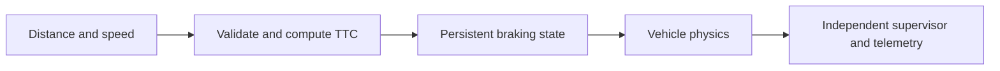
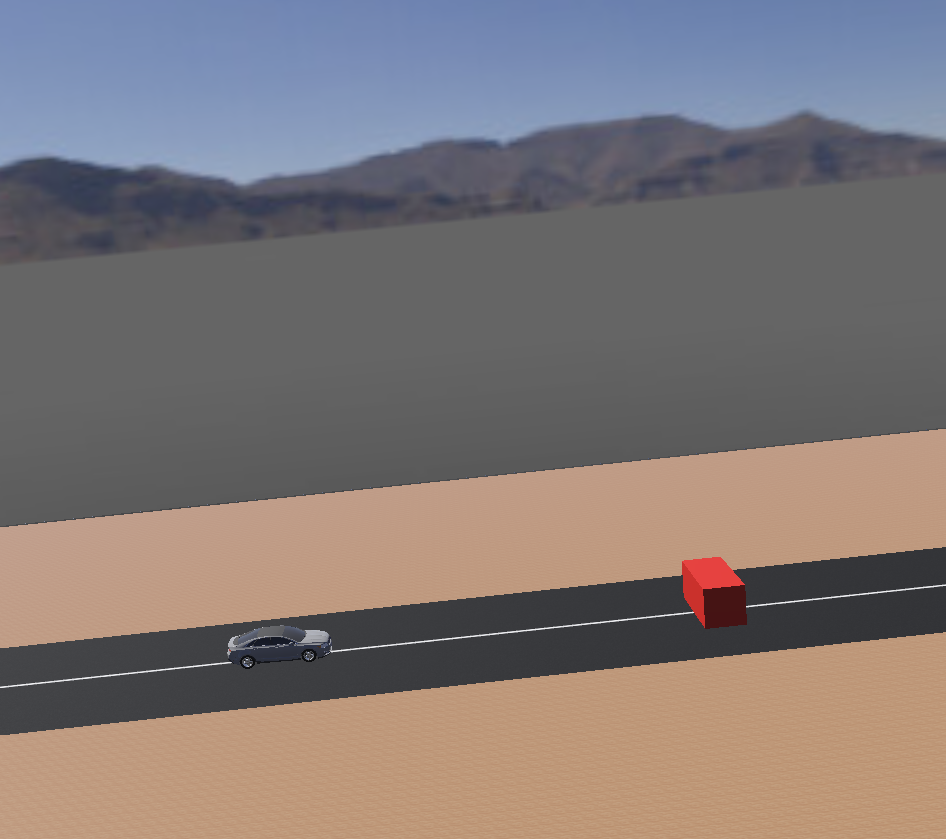

# Autonomous Braking Simulation

**Feras Elghandour**

Connect obstacle sensing, time-to-collision decisions, vehicle control, and independent ground-truth evaluation.

## Implementation

A Webots vehicle controller validates distance and speed readings, enters a persistent braking state, and records telemetry. A separate supervisor checks movement, stopping, collision status, and stopping margin against scenario thresholds.



## Evidence and results

**71 unit tests pass.** Independent rechecking of the saved run confirms no collision, a minimum ground-truth obstacle distance of **15.3837 m**, and final speed **0.0265 m/s**, over a **17.056 s** simulation. The physics run is historical; this release freshly checks its telemetry and controller tests.



## Run locally

Python 3.11 or later; use an isolated environment.

```sh
python -m unittest discover -s tests -v
python scripts/validate_results.py
```

For a new physics run, open `worlds/obstacle_braking.wbt` in Webots R2025a. The world references official version-pinned assets. The controller bindings come from Webots and should not be installed from PyPI. [Architecture](docs/architecture.md) describes the control loop.

## Scope and limitations

One straight-road, static-obstacle scenario. No physical vehicle, moving obstacle, weather robustness, or broader safety claim is established. The simulator and official vehicle assets are external dependencies.

[Validation record](VALIDATION.md) · [Inputs and applicable notices](DATA.md)
