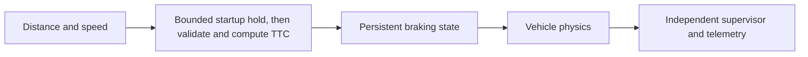

# Autonomous Braking Simulation

**Feras Elghandour**

Connect obstacle sensing, time-to-collision decisions, vehicle control, and independent ground-truth evaluation.

## Implementation

A Webots vehicle controller validates distance and speed readings, enters a persistent braking state, and records telemetry. A separate supervisor checks movement, stopping, collision status, and stopping margin against scenario thresholds.



## Evidence and results

**Nine fresh Webots physics cases passed, with no obstacle contact.** Minimum obstacle-front-face to vehicle-reference distance: **11.05–15.83 m**. The matrix varies requested cruise targets (5/10/15 m/s) and initial reference clearances (20/40/80 m); every run starts from rest. Actual peak speeds are reported below: the 15 m/s target was not reached.


**86 tests pass.** The new physics exposed an unavailable startup speed estimate that permanently held the old controller. A bounded, fully braked initialization now requires three valid samples; later speed/range faults latch zero cruise and full brake. All nine pre-fix failures, nine corrected runs and nine same-seed repeat checks are retained. [Protocol, numerical table, raw telemetry and exact source](results/webots-physics-v1/RESULTS.md).

The earlier saved run remains in [results/run.csv](results/run.csv): no contact, minimum reference distance 15.3837 m, final speed 0.0265 m/s. Its [Webots frame](results/final_screenshot.png) is historical and uses the original world.

## Run locally

Python 3.11 or later; use an isolated environment.

```sh
python -m unittest discover -s tests -v
python scripts/validate_results.py
python scripts/audit_webots_physics.py
```

For a new physics run, open `worlds/obstacle_braking.wbt` in Webots. On macOS 27, stable R2025a falsely reports occupied ports; these runs use the official **R2025b nightly_16_10_2026** containing [upstream fix #7032](https://github.com/cyberbotics/webots/pull/7032). The installed app was preserved. Exact download, hashes and command are in the [protocol](results/webots-physics-v1/protocol.json) and [reproduction guide](results/webots-physics-v1/RESULTS.md).

The world references official version-pinned R2025a assets. Controller bindings come from Webots and should not be installed from PyPI. [Architecture](docs/architecture.md) describes the control loop and evaluation boundary.

## New validation and fail-safe guard

The tests cover startup readiness, initialization timeout, persistent fault braking, generated-world/config consistency and numerical replay checks that reject altered stopping distances, hidden contact and premature acceleration.

A separate **1,836-run kinematic stress comparison** covers speed, clearance, moving obstacles, noise, bias, dropouts, delay and friction. It exposes collisions and inconsistent performance against a fixed-distance baseline. [All results and model limits](results/stress-v1/RESULTS.md).

The kinematic stress results use their recorded earlier controller version and are separate from the new Webots physics evidence.

## Scope and limitations

One straight road, static obstacle and deterministic physics seed. Reference distance is not bumper clearance. Short-gap runs brake before reaching their requested cruise target. No physical vehicle, moving-obstacle physics, weather robustness or broader safety claim is established. The fixed simulator build is an official prerelease; the vehicle assets are external dependencies.

[Validation record](VALIDATION.md) · [Inputs and applicable notices](DATA.md)

## Reuse

The original contributions listed in [LICENSING.md](LICENSING.md) are available under [MIT](LICENSE). This scoped grant preserves upstream notices and separate dataset, simulator, notebook and checkpoint terms.
