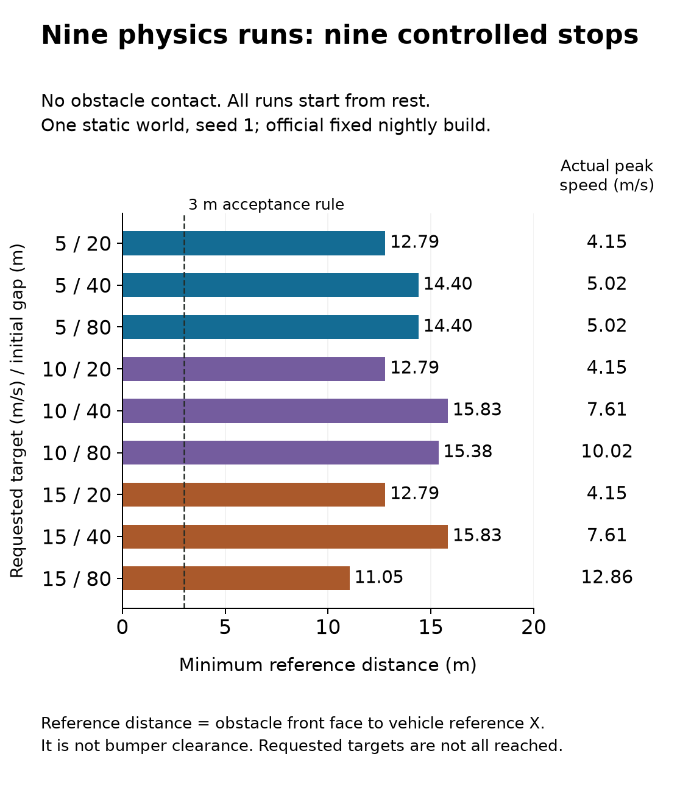

# Fresh Webots physics: startup regression and nine-case validation

Recorded 17 October 2026 on the M2 Max. **Nine final cases passed, with no obstacle contact.** Minimum obstacle-front-face to vehicle-reference distance was **11.0540–15.8321 m**, against the existing 3 m reference-distance acceptance rule. All runs start from rest. These distances are not bumper clearances.



## What changed and what failed first

The installed stable R2025a still failed before loading a world, reporting occupied controller ports when none were listening. An isolated Qt diagnostic reproduced a false successful connection without a peer. Cyberbotics [issue #6976](https://github.com/cyberbotics/webots/issues/6976) and [merged fix #7032](https://github.com/cyberbotics/webots/pull/7032) explain the macOS 27 compatibility defect.

The official **R2025b nightly_16_10_2026** runs the world. It was mounted read-only; the installed application was preserved, and no executable was patched. The DMG SHA-256 matches GitHub's release-asset digest. See [protocol.json](protocol.json) for the exact download, source revision and hash. This is an official prerelease, not a stable-runtime validation claim. World PROTO assets remain pinned to R2025a.

All nine executions of the previous controller then failed by timeout without driving: the Driver speed estimate is unavailable for its first two reported samples. The invalid-speed response held the car permanently. These failures are retained in `before/`, with exact executed source and summaries; no failure was removed from the record.

The corrected controller explicitly initializes for at most one second, holding **zero cruise and full brake**, and requires three consecutive valid range/speed samples before acceleration. Initialization timeout and every later input fault latch zero cruise/full brake until restart. The supervisor counts unavailable initial samples separately only within that bounded hold, with less than 0.05 m independently measured X displacement. Other invalid samples remain failures. Each corrected run recorded two unavailable startup samples.

## Final measured cases

| Requested cruise (m/s) | Initial reference gap (m) | Actual peak speed (m/s) | Minimum reference distance (m) | Final speed (m/s) | Contact | Verdict |
|---:|---:|---:|---:|---:|---|---|
| 5 | 20 | 4.1526 | 12.7869 | 0.0423 | False | Pass |
| 5 | 40 | 5.0185 | 14.4021 | 0.0186 | False | Pass |
| 5 | 80 | 5.0185 | 14.4029 | 0.0186 | False | Pass |
| 10 | 20 | 4.1526 | 12.7869 | 0.0423 | False | Pass |
| 10 | 40 | 7.6085 | 15.8321 | 0.0423 | False | Pass |
| 10 | 80 | 10.0182 | 15.3763 | 0.0265 | False | Pass |
| 15 | 20 | 4.1526 | 12.7869 | 0.0423 | False | Pass |
| 15 | 40 | 7.6085 | 15.8321 | 0.0423 | False | Pass |
| 15 | 80 | 12.8564 | 11.0540 | 0.0107 | False | Pass |

The 15 m/s request was never reached; the highest actual speed was 12.8564 m/s. At a 20 m initial gap all three target settings produce the same early braking behavior. At a 40 m gap the 10/15 m/s requests also brake before reaching either target. This is an acceleration-and-stop matrix, not an emergency-braking test initialized at 5/10/15 m/s.

## Evidence and checks

- `matrix-before.json`, `matrix-after.json`, `matrix-repeat.json`: every case, configuration, execution result and source digest. The after matrix additionally records runtime executable hash and launch arguments.
- `before/`, `after/`, `repeat/`: per-case `summary.json` and losslessly compressed `run.csv.gz` telemetry.
- `source-before.zip`, `source-after.zip`, `source-repeat.zip`: exact executed controllers and runner, world template and all case worlds/configurations. Existing Cyberbotics credits and asset terms remain applicable.
- `runtime-logs.json`, `installed-runtime-retry.log`: runtime output, including the stable-runtime failure.
- `artifacts.sha256.json`: checksums for raw experiment records and source archives.
- `audit.json`: numerical replay of **27 runs / 15,514 telemetry rows**, with no discrepancies in recorded distances, peaks, final speeds, geometry, timing, contact, startup hold or reconstructed acceptance verdicts. The pre-fix CSV predates the speed-validity column; its invalid startup estimate is retained in the failure summary and exact controller source.
- **86 unit tests pass**, including startup readiness/timeout, post-startup fault latching, and audit mutation checks that reject forged stopping margins, hidden contact and premature acceleration.

The first corrected matrix is retained as `repeat/`; the final `after/` matrix was executed again after a source docstring correction. All six listed aggregate outcome fields match exactly for all nine corresponding cases. This uses the same world seed and controller behavior; it adds a repeatability check, not independent statistical trials. The source hashes distinguish the two executions.

## Reproduce

Python 3.11 or later. Use the official build and SHA-256 in `protocol.json`; on macOS 27 the stable R2025a startup probe is affected. Webots provides the controller bindings.

```sh
python -m unittest discover -s tests -q
python scripts/audit_webots_physics.py
WEBOTS_VERSION=R2025b-nightly_16_10_2026 python scripts/webots_matrix.py \
  --out /tmp/braking-new-matrix \
  --webots /path/to/Webots.app/Contents/MacOS/webots --timeout 120
```

Choose a new output directory; the runner refuses to overwrite an existing matrix. GPU training is not used here. Plot regeneration alone needs `matplotlib==3.11.2` and runs with `python scripts/plot_webots_physics.py`.

## Limits

One straight road, static obstacle, fixed vehicle and physics seed. Contact uses simulator contact points; reference distance is obstacle front face to vehicle reference X, not front bumper clearance. Movement, stop and contact measurements come from the independent supervisor; telemetry validity and braking-command checks additionally use the controller's reported messages. Fault injection is covered by software tests, not this physics matrix. No moving-obstacle physics, weather/friction sweep, physical-vehicle validation or certification is established.

The older 1,836-run ideal kinematic stress comparison remains separate and retains its earlier executed source and negative results. It must not be presented as 1,836 Webots physics trials.
